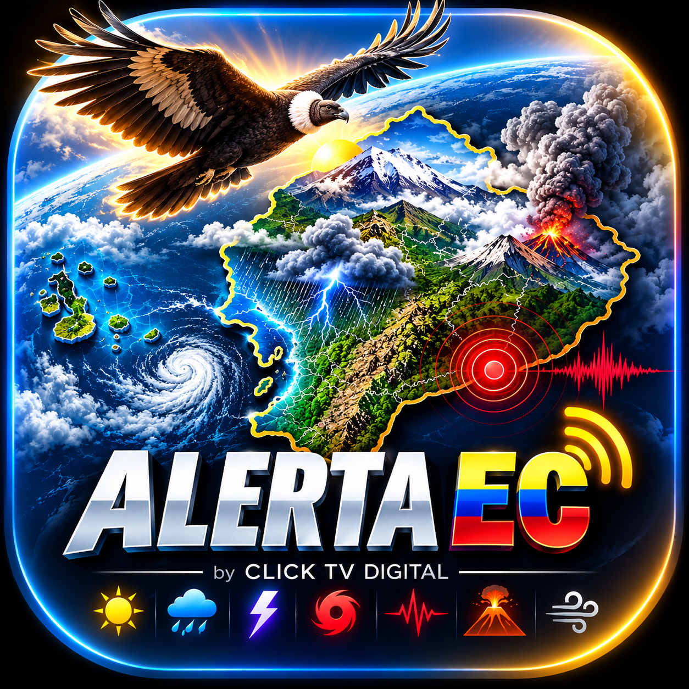

## Paso 632 — Correcciones de auditoría INAMHI (18-10-2026)

Estado: implementación local en `alerta-ec`, pendiente de pruebas unitarias y validación Android. Esta sección sustituye las limitaciones de la revisión INAMHI anterior; el resto del historial se conserva.

- Estilo base MapLibre: hasta dos intentos por vista, espera de 2 s y watchdog de 20 s por intento. Los callbacks tienen token e identidad de vista; se retiran listeners y temporizadores al terminar, pausar o destruir. Al agotar el presupuesto se informa al usuario; una vista nueva permite reintentar.
- Catálogo WMS: una descarga compartida por refresco, con OkHttp ya presente en el proyecto. Cancelar la coroutine llama a `Call.cancel()`; conexión y lectura de 10 s, plazo total HTTP de 30 s, máximo de 4 MiB reales (incluido contenido descomprimido y respuestas sin Content-Length). Se cierra la respuesta también ante errores. Estos límites corresponden a GetCapabilities; las teselas GetMap siguen gestionadas por MapLibre.
- XML: parser SAX real compartido por Android/JVM, sin dependencias nuevas; rechazo obligatorio de DTD y entidades externas mediante lexical handler/resolver. Límites de profundidad, eventos, texto y fechas. Fechas inválidas y capas duplicadas se marcan por capa; XML roto o respuesta de error invalidan el catálogo completo.
- Capas: se conservan fechas aún vigentes durante consulta/error y se informa de ello. Una capa se retira por desactivación, vencimiento o respuesta válida sin fecha seleccionable. Una fecha igual no reconstruye la fuente; una nueva se crea antes de retirar la anterior. Fallos parciales conservan registro de recursos para limpieza posterior. No se confirma descarga ni renderizado de teselas.
- Respaldos: `*.pre_*` excluidos en `.gitignore`, sin borrar ni mover archivos. No había respaldos de ese patrón ya rastreados. Los 263 respaldos registrados al inicio se comprobaron por SHA-256 y permanecen intactos.

Validaciones realizadas: `git diff --check` sin errores; revisión de archivos sin seguimiento relevantes y de cambios frente a la copia inicial; análisis sintáctico PSI de 17 archivos Kotlin sin errores. Esto no comprueba tipos ni compatibilidad de APIs. **Pruebas unitarias no ejecutadas; sin Gradle, compilación Android, APK ni consulta al servicio real.**

Continuidad y matriz de validación pendiente en `docs/CONTINUAR_AQUI.md`, sección «Paso 632».

## Revisión local del módulo INAMHI — 18-10-2026

Esta sección actualiza únicamente el estado de mapas INAMHI y prevalece sobre sus notas históricas inferiores. Cambios locales en `alerta-ec`, sin compilación ni validación Android; no se modifica la estimación global del proyecto.

- Consultas vinculadas a la vista, el estilo y una instantánea de preferencias. Aplicación síncrona en el hilo principal después de consultar WMS; ya no quedan callbacks de aplicación fuera de la tarea. Invalidación antes de cancelar, agrupación de refrescos pendientes y limpieza al pausar/destruir la vista.
- Una consulta GetCapabilities por refresco para las tres capas. Lectura de dimensiones temporales heredadas, listas y rangos de duración fija con límites; rechazo de fechas ambiguas, intervalos inválidos y respuestas de error. Selección de fechas después de recibir la respuesta; retirada conservadora al superar la fecha seleccionada, sin inventar fecha de emisión ni periodo de validez.
- Capas activadas por defecto y desactivación persistente. La preferencia actual prevalece sobre la antigua. Botones «activada/desactivada» describen la elección; el panel distingue consulta, ausencia de fecha, error, vencimiento y teselas solicitadas sin confirmar su visualización.
- Funcionamiento sin GPS, dominio WRF continental separado del alcance nacional de ALERTA EC (incluido Galápagos). El rectángulo configurado no acredita disponibilidad por punto. Unidades y leyenda siguen sin verificar y no se inventan. No se equipara blanco con ausencia de lluvia ni pronóstico con alerta oficial.
- Se conservan PNG transparente y opacidades 0,15/0,10/0,10. Los controles se desplazan dentro de un máximo del 45 % del alto disponible para dejar espacio al mapa. No se alteran las imágenes del proveedor.
- Pruebas unitarias añadidas para invalidación/refrescos, estados, preferencias, dominio continental, URL WMS y lectura/selección temporal. **Pendientes de ejecución**. Revisión sintáctica PSI Kotlin y `git diff --check`: sin errores; no comprueban resolución de tipos, compatibilidad de APIs ni funcionamiento Android.

Pendientes: ejecutar pruebas y compilación en una etapa autorizada; validar en dispositivo rotación, salida/retorno durante consulta, alternancia rápida, cambio de preferencias, mapa sin GPS/red, fallos WMS/teselas, expiración, continente/Galápagos, texto grande y desplazamiento de paneles. Verificar metadatos oficiales, leyenda, unidades y representación de teselas antes de anunciarlos como confirmados. No se comprobó disponibilidad actual del servicio en esta sesión.

<!-- ALERTA_EC_AUDITORIA_20261018 -->
## Estado auditado ALERTA EC v0.1.9 / 109 (18-10-2026)

Auditoria local de Codex, solo lectura, sin compilacion ni validacion Android.

- Avance global estimado: **46/100** (revision provisional del 2026-10-18; implementacion ponderada estimada 65,7 % x factor de validacion 0,70; no equivale a pruebas aprobadas).
- Revision posterior a los pasos 558-598: autosoporte reforzado (cola WorkManager, identificacion de solicitudes, contenido meteorologico, verificacion parcial/completa y cancelaciones). Las pruebas unitarias aun no se han ejecutado ni existe validacion de esta revision en Android. El aumento de implementacion de 62,7 % a 65,7 % es una estimacion de auditoria, no una medicion automatica.
- Implementacion ponderada estimada: **62,7 %**.
- Pendientes prioritarios: autosoporte y cola WorkManager; vigencia y cobertura INAMHI; pruebas meteorologicas; notificaciones multiciudad; intro; GPS/SOS; envio voluntario; accesibilidad y pruebas en Samsung.
- Las funciones futuras aplazadas siguen pendientes y no se declaran completas.
- Informe detallado: docs/ALERTA_EC_AUDITORIA_CODEX_20261018.txt.
- No publicar Release ni ejecutar compilacion integral sin autorizacion.

 

<h1 align="center">ALERTA EC</h1>

<strong>CLICK TV DIGITAL</strong>

 

  
  
  
  
   
  
    
  

<h4 align="center">Aplicación Android de código abierto en desarrollo, orientada a información meteorológica y alertas para Ecuador. La disponibilidad y precisión de los datos dependen de las fuentes y su cobertura; las funciones propias requieren validación progresiva.</h4>

ALERTA EC es un proyecto derivado no oficial de [Breezy Weather](https://github.com/breezy-weather/breezy-weather), desarrollado por **CLICK TV DIGITAL**. Conserva la licencia original y las atribuciones a sus autores y colaboradores. No es una publicación del equipo de Breezy Weather ni está afiliado oficialmente a ECU 911 o a instituciones gubernamentales. Consulta el [estado y los pendientes del proyecto](docs/CONTINUAR_AQUI.md).

## Prueba previa a release posterior a v0.1.8 — 2026-10-17

**Estado actual: código preparado localmente; APK todavía no compilado ni probado.** Esta sección prevalece sobre los registros históricos inferiores. Rama `alerta-ec`, versión base comprobada en Gradle **0.1.8 / 108**; no se incrementó versión ni se publicó release o tag. Sin commit ni push.

- Notificaciones: actualizaciones, alertas graves, precipitaciones y pronósticos de hoy/mañana quedan habilitados si no existe una preferencia guardada. Se respetan los valores guardados, incluidos los desactivados. Los trabajos de pronóstico ya no guardan `false` al faltar permiso; al volver a la pantalla principal se reprograman si hay permiso y no están activos. El permiso Android, los horarios, la actualización en segundo plano y la disponibilidad de fuentes siguen siendo necesarios.
- Acerca de: logo conservado, marca, CLICK TV DIGITAL y versión en renglones separados y centrados. Una única ficha de Richard Ontaneda con el texto «Fundador de CLICK TV DIGITAL, creador y desarrollador principal de ALERTA EC. 🇪🇨». Atribución a Breezy Weather y LGPL-3.0 en el desplegable junto a los créditos originales; acceso a licencias conservado.
- Donativos: dimensiones de logos más equilibradas; los tres PNG antiguos eliminan en memoria el blanco exterior conectado a sus bordes. Se conservan los blancos interiores, recursos originales, enlaces, QR y comportamientos. Pendiente inspección visual de bordes y contraste en Android.
- Detalle horario: gráfica encima, encabezado de desplazamiento/hora destacado, datos meteorológicos en otra línea y recepción debajo con color secundario del tema; separación entre intervalos, altura flexible y sin truncar texto. Se conservan unidades, estados y datos ausentes.
- CI prepara `:app:assembleBasicDebug` y un artefacto `alerta-ec-prueba-post-v0.1.8-<SHA>` con retención de 7 días, además de las verificaciones existentes. Solo se ejecutará tras un push autorizado o PR; no crea Releases. Usa la variante `.debug` existente y firma de depuración: no sirve para comprobar actualización sobre producción. No se modificaron `applicationId`, keystore, firma de producción ni secretos.

Verificación local: `git diff --check`, `python scripts/validate_alerta_ec.py`, parseo de los XML modificados y unicidad de sus claves de cadenas. No se ejecutó Gradle en Termux ni CI remoto. No hay APK nuevo disponible todavía.

Prueba Android pendiente: instalación Debug limpia y valores predeterminados; desactivar opciones y comprobar persistencia tras reiniciar; denegar/conceder permiso y verificar planificación/entrega real de hoy y mañana; alertas y precipitación con fuente disponible; tema claro/oscuro, texto grande y TalkBack; logos sin halos o pérdida de detalle, apertura de enlaces y QR originales; datos horarios ausentes/antiguos, cambio de día y recepción. Comprobar también intro y regresiones registradas abajo. Antes de una release posterior hará falta un APK firmado de prueba y validar actualización conservando datos.

Los archivos locales sin seguimiento `AGENTS.md` y `ALERTA_EC_GITHUB_CI_RELEASE_2026-10-14.txt` se conservan intactos. Siguiente paso: revisar diff, autorizar commit/push, esperar CI y descargar el APK de prueba; no crear tag final ni publicar hasta completar pruebas y recibir autorización.

## Características de ALERTA EC implementadas en código

Esta tabla describe funciones presentes en el código del repositorio; no garantiza que hayan superado pruebas en dispositivo o que estén disponibles en la última Release. La base meteorológica procede de Breezy Weather; los datos visibles dependen del proveedor, la ubicación y su vigencia.

| Característica | Evidencia de implementación y límites |
| --- | --- |
| Introducción con identidad ALERTA EC y CLICK TV DIGITAL | [Controlador de la intro](app/src/main/kotlin/org/breezyweather/ui/main/intro/AlertaEcIntroController.kt), conectado a la pantalla principal: escenas animadas, omisión, movimiento reducido y control de sonido con siete pistas. Pendientes validación visual, escucha y accesibilidad en dispositivo. |
| Resumen del pronóstico horario | [Vista horaria](app/src/main/kotlin/org/breezyweather/ui/main/adapters/main/holder/HourlyViewHolder.kt): muestra datos meteorológicos disponibles, hora prevista, adquisición y estados de disponibilidad mediante el resumen horario. Pendientes pruebas funcionales; no equivale a observaciones ni seguimiento por radar. |
| Organización de direcciones para Ecuador | [Mapeo de direcciones](app/src/main/kotlin/org/breezyweather/background/location/EcuadorAddressMapper.kt), utilizado por el proveedor de dirección detallada: separa barrio, sector, parroquia, cantón y provincia según los datos recibidos. No garantiza exactitud postal ni cobertura completa. |
| Clasificación y notificaciones meteorológicas | [Adaptador](app/src/main/kotlin/org/breezyweather/alertaec/AlertaEcWeatherAdapter.kt) y [notificador](app/src/main/kotlin/org/breezyweather/alertaec/AlertaEcNotifier.kt), llamado desde la actualización en segundo plano: distinguen pronósticos y alertas de la fuente, incorporan datos disponibles y filtran duplicados. Las alertas oficiales y la precipitación minutely conservan su ruta original. Pendientes pruebas de recepción, permisos y datos vencidos. |
| Compartir la aplicación y aportes voluntarios | [Pantalla Acerca de](app/src/main/kotlin/org/breezyweather/ui/about/AboutScreen.kt): integra compartir ALERTA EC y la sección de apoyo. Pendiente validar el flujo en dispositivo; no se afirman transacciones verificadas. |

El motor multiamenaza completo, SOS, reportes ciudadanos, mapas offline/relieve 3D y seguimiento de lluvia con trayectoria o cuenta regresiva siguen siendo objetivos por fases. Los nombres de fenómenos en los modelos no demuestran una integración operativa de fuentes para cada amenaza.

### Base técnica comprobada por inspección

- **API mínima 24:** definida en [AndroidConfig.kt](buildSrc/src/main/kotlin/breezy/buildlogic/AndroidConfig.kt) y aplicada por [ProjectExtensions.kt](buildSrc/src/main/kotlin/breezy/buildlogic/ProjectExtensions.kt). Es un requisito configurado, no una garantía de pruebas en todos los dispositivos.
- **Kotlin, Jetpack Compose y Material 3:** el [módulo de la aplicación](app/build.gradle.kts), las convenciones de compilación y el [catálogo de dependencias](gradle/libs.versions.toml) declaran su uso. La insignia describe tecnologías, no certificación visual ni compilación exitosa.

## Corrección de consentimiento de audio — v0.1.6 (2026-10-15)

- Corregida la lectura de `sound_enabled`: una preferencia ausente significa sonido apagado. Inicio, etiqueta del control y alternancia usan la misma lectura; solo el botón guarda la elección. Los valores `true` y `false` ya guardados se conservan, sin migración ni sobrescritura.
- El valor predeterminado anterior `true` podía permitir audio sin activación explícita cuando el timbre, volumen y foco lo permitían. Esas barreras no sustituyen el consentimiento.
- Revisión estática: omisión, final, pausa, destrucción y movimiento reducido detienen audio; pérdida de foco cancela pistas y libera reproductores. Silencio/vibración y volumen multimedia cero bloquean el inicio. No se cambió el reproductor ni la cronología.
- Añadidas pruebas unitarias para preferencia ausente, valores guardados y ausencia de escrituras al leer; ampliada la cobertura de la política al modo vibración. No ejecutadas: Gradle no se ejecuta en Termux. Pendientes CI y pruebas de audio/foco/ciclo de vida en dispositivo; los cambios de timbre durante la reproducción no se monitorizan continuamente.
- Se preservaron el logo y la identidad de ALERTA EC; comprueba en GitHub Actions el resultado de CI y en Releases cuál es la última versión realmente disponible.

## 📱 Capturas oficiales de ALERTA EC

Las capturas verificadas de la aplicación se incorporarán después de instalar y probar la **compilación que se valide en Android** en Android. Mostraremos pantallas reales de ALERTA EC, preferentemente con una ubicación pública de Quito o Ecuador, sin divulgar domicilios ni datos personales.

**El logotipo superior sí es el oficial de ALERTA EC.** No se utilizarán capturas del proyecto original Breezy Weather como si fueran pantallas propias. Ver el [plan de documentación y capturas](docs/CONTINUAR_AQUI.md).

# ⬇️ Descarga de ALERTA EC

Las descargas propias se encuentran en [Releases de ALERTA EC](https://github.com/clicktvdigital/Alerta-EC/releases). Para uso público, elige únicamente una Release estable con APK de producción; las versiones marcadas como preliminares, los APK Debug y los artefactos de CI son de prueba. Si no hay una Release estable disponible, espera su publicación.

### Obtainium

1. Instala [Obtainium desde su proyecto oficial](https://github.com/ImranR98/Obtainium).
2. En la opción para añadir una aplicación, introduce la URL del repositorio: `https://github.com/clicktvdigital/Alerta-EC` y utiliza la fuente GitHub.
3. Mantén desactivada la inclusión de versiones preliminares (*pre-releases*). Guarda la aplicación y selecciona el APK de producción compatible con tu dispositivo (universal, si está disponible).
4. Comprueba que corresponde a ALERTA EC, paquete `com.clicktvdigital.alertaec`. Si no se detecta una versión estable con APK, espera su publicación; no uses el repositorio de Breezy Weather como sustituto.

Consulta también la [documentación oficial de Obtainium](https://wiki.obtainium.imranr.dev/). La detección y actualización de una nueva Release de ALERTA EC debe comprobarse antes de distribuirla.

**Firma de producción:** la huella SHA-256 queda pendiente de validación criptográfica contra un APK de producción y la versión instalada antes de incorporarla a esta sección. El registro histórico de continuidad no sustituye esa comprobación. Un checksum SHA-256 del archivo APK es distinto de la huella de su certificado de firma.

Las fichas de Breezy Weather en F-Droid e IzzyOnDroid, sus APK y su certificado pertenecen al proyecto original; no son canales ni credenciales de distribución de ALERTA EC.

## 📜 Procedencia, licencia y agradecimientos

**ALERTA EC** es una adaptación independiente desarrollada dentro de **CLICK TV DIGITAL**, basada en [Breezy Weather](https://github.com/breezy-weather/breezy-weather). Agradecemos el trabajo de sus autores y colaboradores. Se conservan sus avisos de derechos de autor y la licencia [LGPL-3.0](LICENSE); la documentación original se consulta [en su repositorio](https://github.com/breezy-weather/breezy-weather). Esta aplicación **no** es una publicación de sus mantenedores.

ALERTA EC tampoco está afiliada oficialmente al **ECU 911** ni a instituciones gubernamentales. Sus funciones de SOS remoto y rescate comunitario siguen en desarrollo y no sustituyen los servicios de emergencia.

## Registro histórico de preparación anterior (2026-10-17)

Se corrigió el fondo opaco de la intro y se añadió portada hasta el primer fotograma, silencio hasta que haya imagen y recuperación por error/timeout. La gráfica horaria prioriza precipitación disponible y muestra el detalle debajo; el resumen cuadrado queda con las mediciones. Donativos incorpora logos locales y el nuevo PayPal. Acerca de destaca ALERTA EC / CLICK TV DIGITAL y permite desplegar atribuciones sin duplicar al desarrollador ni eliminar licencias.

**Pendiente de CI y validación en Android.** El MP4 no se recodificó: la inspección binaria indica H.264 High 4.0, 720×1280 y 12,052 s; la decodificación local está bloqueada por una biblioteca de Termux. GitHub Actions queda preparado para decodificarlo y guardar primeros fotogramas en `intro-review`, además de las pruebas Kotlin. La disponibilidad HTTP de los enlaces no verifica pagos ni destinatarios. Banco Pichincha es el banco con recursos existentes; no se inventaron otros cobros.

Se mantienen `com.clicktvdigital.alertaec`, versión 0.1.6 / 106 y firma de producción. No se compiló Android localmente ni se publicó. Consulta los [cambios, pruebas pendientes y procedimientos de recuperación](docs/CONTINUAR_AQUI.md#preparación-de-la-siguiente-actualización-estable--2026-10-17) y las [fuentes de marcas](artwork/alerta-ec/donaciones/MARCAS.md).

## ❤️ Apoya el desarrollo de ALERTA EC

ALERTA EC es **gratuita y de código abierto**. Si deseas respaldar su mantenimiento, puedes realizar un aporte completamente voluntario. ☕🇪🇨

  
  &nbsp;
  
    
  
  &nbsp;
  

<small>Los botones enlazan con las plataformas indicadas; verifica el destinatario antes de completar un pago. La disponibilidad de cada método y las transacciones no han sido comprobadas en esta revisión.</small>

### 🇪🇨 Aportes con QR desde Ecuador y el exterior

Los siguientes códigos fueron compartidos por el responsable de CLICK TV DIGITAL. **Antes de donar, comprueba en la plataforma el destinatario y el importe.** La lectura del código no equivale a una transacción verificada.

| Método | QR de aportes | Abrir el enlace |
|---|---|---|
| **PayPhone** |  | [Abrir PayPhone](https://ppls.me/izAAuu8fptGHF6uZBV9L4Q) |
| **Banco Pichincha / Deuna** |  | [Abrir el cobro](https://pagar.deuna.app/H92p/person?id=v1e_WT373U4AKPZ46YWW) |
| **Deuna** |  | [Abrir Deuna](https://pagar.deuna.app/H92p/person/payment?id=858a7565a7fa5e9bc2302b7836e1fdf2d8635300) |
| **Binance Pay** |  | [Abrir Binance Pay](https://app.binance.com/uni-qr/RMqefYgh) |

Los enlaces de Banco Pichincha y Deuna utilizan infraestructura de Deuna. **Son aportes voluntarios; no sustituyen ni condicionan el acceso gratuito a ALERTA EC.**

<!-- ALERTA_EC_QR_APORTES_2026_10_16_V1 -->
**Desde un celular:** toca el enlace correspondiente al método de pago; no necesitas escanear tu propia pantalla.
La aplicación también ofrecerá botones grandes para abrir enlaces, consultar QR y compartir ALERTA EC.
**Volver a ALERTA EC no confirma un cobro:** se preguntará al usuario si desea indicar que completó su aporte;
la valoración de 1 a 5 estrellas es voluntaria y se envía por correo, sin generar una reseña automática.
<!-- ALERTA_EC_APOYOS_ACCESIBLES_2026_10_16_V2 -->

**Los aportes no habilitan servicios exclusivos ni otorgan prioridad en emergencias.** El acceso a las funciones meteorológicas esenciales sigue siendo gratuito.

🧰 Consultar registro técnico, planes y avances históricos

## Ubicacion avanzada y referencias comunitarias

Alerta EC prepara GPS detallado, altitud, relieve 3D y referencias comunitarias verificables para Ecuador. Atucucho es zona piloto; la ubicacion sera dinamica para todos los usuarios. Las coordenadas privadas y puntos de domicilio no se publicaran. Ver docs/CONTINUAR_AQUI.md para requisitos, estado y validaciones.

### Notificaciones Alerta EC: clasificación y deduplicación

- Las notificaciones de precipitación minutely siguen bajo `Notifications.checkAndSendPrecipitation`; Alerta EC no emite una segunda notificación para esos mismos datos.
- La ruta minutely del adaptador Alerta EC está inactiva y documentada hasta contar con una estrategia que no duplique el aviso original.
- `FORECAST` conserva la etiqueta de pronóstico. `OBSERVED` no se genera ni se notifica mientras no exista una fuente observacional real; `OFFICIAL_EVENT` se atiende únicamente desde `remoteviews.Notifications`.
- La deduplicación filtra IDs ya notificados y eventos repetidos en una misma actualización.
- GitHub Actions ejecutará `:app:testBasicDebugUnitTest` y la compilación Kotlin Release. No se ejecutó Gradle localmente en Termux.

## Alerta EC: visión funcional para Ecuador

Alerta EC es una adaptación independiente de Breezy Weather para ofrecer información meteorológica, alertas y referencias territoriales útiles en Ecuador. El producto debe explicar qué se sabe, de qué fuente viene, cuándo se actualizó y con qué incertidumbre. Pronósticos, observaciones, alertas oficiales y reportes ciudadanos deben permanecer claramente diferenciados. Las funciones enumeradas como visión o pendientes no se consideran implementadas hasta contar con código operativo y validación.

### Información y experiencia previstas

- Ubicación por niveles administrativos separados: calle/intersección, barrio o sector, parroquia civil, parroquia eclesiástica cuando una fuente confiable la identifique, distrito/cantón, provincia y código postal. La geocodificación debe conservar fuente, confianza y antigüedad. Para el caso de referencia del usuario, el código postal [código postal residencial omitido] está confirmado por el usuario y fuentes postales oficiales; Nominatim ha devuelto 170318 para un punto de prueba y esa discrepancia debe conservarse. Ningún código postal se debe fijar para todos los usuarios.
- Zona horaria de Quito, UTC−05:00, con hora y segundos cuando la precisión temporal del dato lo permita. Un reloj o cuenta regresiva no debe implicar precisión meteorológica que la fuente no tiene.
- Temperatura en grados Celsius, acumulación de lluvia en milímetros y tasa de precipitación en mm/h, explicando intervalo y significado. El pronóstico por horas es prioritario; el pronóstico diario es complementario.
- Seguimiento de lluvia por barrio solo cuando haya cobertura espacial suficiente. Radar y satélites deben ser productos reales, identificados por fuente, hora, cobertura y licencia; distinguir observación de animaciones/modelos de pronóstico. No inferir trayectoria, procedencia o ETA desde un único pronóstico puntual.
- Calidad del aire explicada en lenguaje sencillo, con contaminantes e índice cuando estén disponibles, hora, fuente y recomendaciones; no presentar estimaciones como mediciones locales.
- Recomendaciones breves asociadas al riesgo y al nivel de confianza. Accesibilidad desde el diseño: lectores de pantalla, contraste y texto configurables, voz/TTS, sonido y vibración opcionales, y controles sencillos.
- Mapas y referencias comunitarias con procedencia y privacidad; reportes ciudadanos marcados como no verificados hasta corroboración. Las funciones de SOS, comunicación comunitaria, cámaras y seguimiento de rutas requieren implementación, controles de privacidad y validación antes de anunciar disponibilidad.

### Fuentes a evaluar e integrar con verificación

INAMHI, IG-EPN, SGR, COE, ECU 911, AMT, EPMMOP, MTOP, REMMAQ, GeoQuito, NOAA y canales oficiales en X, además de fuentes meteorológicas existentes compatibles. Antes de usar cada fuente se deben confirmar endpoint, cobertura, actualización, calidad, permisos, atribución y términos/licencia. Una publicación en X o un reporte ciudadano no confirma automáticamente una emergencia. No acceder a cámaras restringidas de ECU 911; usar únicamente transmisiones públicas autorizadas. Radar, imágenes satelitales, cámaras y cartografía pueden tener restricciones de redistribución o uso comercial: no copiar, retransmitir ni almacenar sin autorización comprobada.

### Estado de implementación

La base heredada de Breezy Weather, los modelos y adaptador inicial de eventos Alerta EC, los pronósticos horarios, deduplicación y política de estados existen parcialmente. El minutely sigue atendido por la notificación original de Breezy Weather para evitar duplicados; sus valores de Open-Meteo representan pronóstico en intervalos de 15 minutos convertido a tasa equivalente mm/h, nunca observación. Radar/satélite ecuatorianos integrados, alertas de las instituciones enumeradas, vigilancia por barrios, recomendaciones contextuales, reportes comunitarios, parroquia eclesiástica y una interfaz completa de accesibilidad siguen pendientes o sujetos a validación. Consulta [docs/CONTINUAR_AQUI.md](docs/CONTINUAR_AQUI.md) para el estado técnico y las decisiones acumuladas.

**Regla de mantenimiento:** toda función nueva o decisión de producto debe actualizar README.md con el cambio funcional y docs/CONTINUAR_AQUI.md con el estado técnico, decisión, pendientes y riesgos correspondientes antes de cada commit.

## Widget meteorológico Alerta EC — fase 1

El widget prioriza condiciones actuales, lluvia próxima pronosticada y acumulación horaria; muestra los milímetros acumulados por intervalo separados de la tasa en mm/h. Los horarios corresponden a la zona de la ubicación y se incluye la antigüedad de actualización en la descripción accesible. Ecuador usa °C en modo automático, respetando unidades elegidas manualmente. No se presentan pronósticos como observaciones ni se inventan radares o tiempos de llegada.

La previsión Hourly Trend también ofrece texto accesible para cada hora mostrada. La primera fase reutiliza las seis celdas horarias visibles que ya ofrecen los layouts Material You; expandirlas visualmente a 12–24 horas según el tamaño, validar TalkBack/dispositivo y ejecutar CI siguen pendientes. Sin datos minutely el widget indica que no hay pronóstico de corto plazo.

## CI en `550df16d` (2026-10-14)
- Los runs 38490947969 (APK Debug) y 38490946868 (Verificación continua) fallaron al compilar `HourlyTrendWidgetIMP.kt:315`: faltaba importar la extensión `Location.getPlace`, por lo que Kotlin no resolvía la llamada de descripción accesible del widget horario. Ambos logs apuntan a esta misma causa; el job de pruebas tampoco alcanzó a ejecutar las pruebas unitarias.
- Se agregó el import de la extensión existente. No se cambió el texto accesible, las funciones del widget ni la configuración de CI.
- Pendiente: CI y pruebas unitarias tras el push, y pruebas visuales/accesibles en dispositivo. No se ejecutó Gradle en Termux.

## Intro cinematográfica de Alerta EC

Se conservan el logo, el cóndor y las escenas de fenómenos. La intro ofrece una opción accesible y persistente de movimiento reducido, con una composición estática y una preferencia explícita de sonido. Se eliminaron los destellos intensos en todos los modos. La infraestructura de reproducción está limitada por volumen, modo silencioso y liberación al omitir o cerrar. **Los efectos ambientales reales siguen pendientes:** no hay recursos de audio propios o con licencia pública verificable en el repositorio; no se descargaron ni añadieron pistas. La preferencia activada no produce sonido mientras no exista una pista aprobada. No se genera TTS automáticamente.

## Intro cinematográfica: efectos originales (2026-10-14)

Estado: pistas procedurales implementadas e integradas; validación en dispositivo y CI pendiente. Esta actualización reemplaza el estado histórico inmediatamente anterior de “audio pendiente”.

- Se generaron localmente con síntesis digital determinista siete WAV originales, sin grabaciones descargadas: viento (5,0 s), tormenta distante (1,8 s), sismo (1,2 s), ambiente volcánico (1,5 s), lluvia (2,0 s), deslizamiento (1,4 s) y cierre armónico (1,4 s). El tamaño conjunto es aprox. 0,60 MiB (630.938 bytes).
- Archivos en `app/src/main/res/raw/alertaec_intro_{wind,storm,seismic,volcano,rain,landslide,closing}.wav`; mono PCM 16-bit, 22.050 Hz, picos limitados a 0,68 de escala digital (aprox. −3,35 dBFS), con entradas/salidas suaves. El guion reproducible es `scripts/generate_alerta_ec_intro_audio.py`; su autoría es propia y no tiene dependencias ni material de terceros.
- `IntroAudioPlayback` solicita Audio Focus transitorio y crea/reproduce/libera cada MediaPlayer por efecto. Límite por pista 0,12; no comienza sin activación explícita persistente, volumen multimedia disponible y modo de timbre normal. Omisión, movimiento reducido, pérdida de foco, pausa y destrucción cancelan tareas, detienen y liberan reproductores y abandonan foco. El sonido sigue apagado inicialmente; no hay TTS.
- Sincronía con el timeline existente: viento 0 ms; tormenta 250 ms; sismo 300 ms; volcán 1.250 ms; lluvia 3.150 ms; deslizamiento 3.350 ms; cierre 3.900 ms. No se alteraron escenas, logo o cóndor; el destello permanece desactivado y el modo de movimiento reducido sigue silenciando la intro.
- La duración final se amplió a 5,8 s: permite que terminen la lluvia (5,15 s) y el cierre (5,3 s) antes de ocultar la intro; el fundido comienza a 5,3 s.
- Verificación estática realizada por el generador: formato PCM, canales, frecuencia, duración exacta, integridad de lectura y pico de cada pista. No se ejecutó Gradle en Termux. Pendiente probar audición/foco en dispositivo y CI.

### Ajustes de estabilización (2026-10-14)
- La reducción de movimiento también consulta `ValueAnimator.areAnimatorsEnabled()` en Android 8 o posterior, además de la escala global; valores de escala no finitos o iguales/menores que cero se tratan como movimiento reducido.
- La ruta de audio aplica la política probada de consentimiento, recurso disponible, modo de timbre normal y volumen multimedia distinto de cero. Liberar un reproductor ya detenido no interrumpe la limpieza del resto.
- El adaptador de alertas conserva los eventos oficiales en `remoteviews.Notifications` y los deduplica por identificador en su propia ruta. La lluvia por minuto sigue siendo exclusiva del notificador previo de Breezy Weather; el evento Alerta EC de pronóstico es horario.
- No hay en este checkout un widget horario Alerta EC aislado con su propio sonido/TTS. Los widgets generales muestran pronósticos y los datos minutely disponibles; no se añadieron avisos de 60/30/15/5/1 minutos ni voz porque la fuente horaria no permite respaldar esos tiempos. El TTS de alertas sigue pendiente de diseño y deduplicación compartida.
- Verificación de esta revisión: `git diff --check`, inspección de recursos WAV con `file`, lectura estática de flujos de audio, ciclo de vida, widget/notificación. No se ejecutó Gradle, CI ni prueba en dispositivo.

## Continuidad verificada — 2026-10-14

- PRIORIDAD: preservar avances y decisiones en GitHub.
- Intro cinematografica: composicion y siete pistas de audio procedurales documentadas; faltan CI y pruebas reales de audio en dispositivo.
- Widget meteorologico: fase 1 implementada en codigo; faltan CI, pruebas visuales, accesibilidad y ampliacion de horizonte.
- Alertas: adaptador meteorologico y modelos iniciales existentes; motor multiamenaza, avisos anticipados, sonidos por fenomeno, vibracion y voz TTS pendientes de integracion y validacion.
- Ubicaciones: GPS, calles, barrios, parroquias, altitud y referencias comunitarias pendientes de completar y verificar; no publicar domicilios privados.
- Donaciones: ui/support/SupportSection.kt creado y conectado localmente a AboutScreen.kt; faltan formulario, WhatsApp, pruebas y CI. No afirmar que esta publicado.
- Resenas: usar opiniones reales, moderadas, con posible lectura desde GitHub; no publicar opiniones ficticias.
- Proxima prioridad: completar aportes, revisar intro/widget/alertas, ejecutar CI y pruebas en dispositivo.
- Codex: utilizarlo para implementar tareas por modulos y documentar resultados.
- Version publica documentada: 0.1.4 / 104; mantener applicationId y certificado de produccion.
- No publicar Release, tag ni APK nueva sin pruebas, firma verificada y autorizacion.
- Actualizar README.md y docs/CONTINUAR_AQUI.md en cada avance; mantener cada proyecto en su propio repositorio.

## 👨‍💻 Autoría y equipo

  
  &nbsp;&nbsp;&nbsp;
  
  
<strong>Richard Ontaneda</strong>

  
Creador y desarrollador de ALERTA EC · Fundador y creador de CLICK TV DIGITAL

  
<strong>ALERTA EC 🇪🇨 — un proyecto de CLICK TV DIGITAL</strong>

La sección automática **Contributors** de GitHub muestra perfiles de las cuentas que aportaron commits; no admite sustituir sus avatares por logos personalizados. Por eso la identidad visual del proyecto está disponible aquí.

<!-- ALERTA_EC_README_PUBLICO_2026_10_16 -->

## Ubicación local y notificaciones

El nombre meteorológico prioriza barrio o sector explícito devuelto por geocodificación, después parroquia/distrito y ciudad. No se presupone Atucucho a partir de Cochapamba. En las preferencias de cada ubicación, incluida la actual, puedes definir una etiqueta manual: no cambia las coordenadas del pronóstico y debes revisarla al desplazarte.

Los resúmenes horarios muestran fenómeno, lugar, intervalo, probabilidad, precipitación acumulada y temperatura; las alertas y el estilo nativo separan los detalles en la vista expandida. Se mantienen canales, permisos y preferencias. Un intervalo ya iniciado no se presenta como futuro.

Cambios pendientes de compilación y validación visual en Android; las comprobaciones locales son estáticas. Consulta los límites de precisión y las pruebas pendientes en [CONTINUAR_AQUI](docs/CONTINUAR_AQUI.md).

### Revisión de GPS y precisión meteorológica (2026-10-17)

La actualización conserva coordenadas originales y metadatos de Android, evita volver al punto anterior por fallos de geocodificación y muestra precisión, altitud y hora en preferencias de ubicación. Incluye límites/caché de Nominatim y mantiene la etiqueta manual independiente del GPS. La resolución del clima no equivale a precisión GPS; no se confirmó radar de barrio ni se añadió una fuente hiperlocal. Consulta [hallazgos, fuentes y pruebas pendientes](docs/ALERTA_EC_GPS_METEOROLOGIA.md). Sin compilación ni validación Android todavía.

### Iconos y vibración de notificaciones

Los avisos meteorológicos usan iconos pequeños vectoriales monocromáticos según el fenómeno; se conserva el logotipo ALERTA EC. Las instalaciones nuevas separan pronósticos discretos, precipitación con vibración corta y alertas oficiales graves/extremas con patrones diferenciados. Las instalaciones existentes conservan sus canales y preferencias: no se migran automáticamente a canales que puedan eludir un bloqueo. La vibración depende de permisos, ajustes individuales, silencio, No molestar y hardware.

Se reutiliza la ubicación barrio, parroquia, ciudad sin inventar Atucucho, Cochapamba o Quito. Se limita la repetición de avisos y no se convierte un pronóstico de lluvia en una alerta oficial grave. Consulta el [diagnóstico, restablecimiento manual y pruebas pendientes](docs/CONTINUAR_AQUI.md#notificaciones-android-iconos-y-vibración-2026-10-17).

<!-- ALERTA_EC_AUTO_START -->

# ALERTA EC - ESTADO MAESTRO DEL PROYECTO

Actualizado: 2026-10-13
Proyecto: Alerta EC
Repositorio: clicktvdigital/Alerta-EC
Rama de desarrollo: alerta-ec

## OBJETIVO
Sistema ecuatoriano de vigilancia meteorologica, emergencias naturales, seguridad vial y avisos territoriales, con GPS, mapas, notificaciones, sonido, vibracion y voz.

## ESTADO REAL
- Base Android: existente.
- Modelos AlertaEcPhenomenon y AlertaEcEvent: creados; integracion pendiente.
- Correcciones de notificaciones y cancelacion: modificadas localmente; compilacion y pruebas pendientes.
- Preferencias de sonido, vibracion y voz: estructura inicial; integracion pendiente.
- Motor multiamenaza: pendiente.
- Motor de vigilancia vial: pendiente.
- Integracion de fuentes oficiales: pendiente.
- Camaras publicas autorizadas: pendiente.
- Radar y seguimiento geografico: pendiente.
- Notificaciones por voz y sonidos especificos: pendiente.
- Widget meteorológico fase 1: código local implementado con condiciones actuales, lluvia minutely pronosticada, acumulación horaria, antigüedad y descripción accesible; CI/pruebas/dispositivo pendientes. Cuenta regresiva: pendiente.
- Intro cinematográfica: composición y accesibilidad conservadas; pistas ambientales originales sintetizadas e integradas en `res/raw`, con reproducción opt-in y MediaPlayer/AudioFocus. Ver actualización detallada al final del documento; CI y validación en dispositivo pendientes.
- Resumen diario de las 09:00 dentro de Android: pendiente.

## FENOMENOS NATURALES
Lluvia, lluvia fuerte, tormenta electrica, granizo, viento, inundacion, deslizamiento, sismo, actividad volcanica, incendio, niebla, nieve, calor extremo, frio extremo, ciclon tropical y tsunami.

## VIGILANCIA VIAL
Accidentes, choques, volcamientos, cierres, baches, derrames, obstaculos, inundaciones viales, deslizamientos, fallas de semaforos y restricciones oficiales.

## FUENTES POR EVALUAR
INAMHI, Instituto Geofisico, ECU 911, Gestion de Riesgos, COE, AMT, EPMMOP, instituciones viales, medios de comunicacion, canales RSS y publicaciones oficiales en X.

Verificar disponibilidad, permisos, frecuencia de actualizacion, condiciones de uso y calidad de cada fuente antes de integrarla.

## VIGILANCIA GEOGRAFICA
- Ubicacion GPS actual.
- Sectores favoritos y zonas cercanas.
- Quito, Atucucho, La Carolina, Valle de Los Chillos y otras zonas configurables.
- Distancia y relevancia respecto de la ubicacion o ruta.
- No confundir pronostico, observacion, reporte ciudadano y alerta oficial.

## NOTIFICACIONES
- Clasificacion por fenomeno, gravedad, fuente y ubicacion.
- Sonido diferenciado cuando corresponda.
- Vibracion y notificacion por voz.
- Evitar avisos repetidos y eventos caducados.
- Alertas de lluvia 10, 5 y 1 minuto antes solo si los datos permiten esa precision.
- Cuenta regresiva de segundos solo con respaldo tecnico suficiente.
- Nunca predecir terremotos ni inventar magnitudes, intensidades u horas exactas.

## CAMARAS Y MAPAS
- Reproductor de transmisiones publicas autorizadas.
- No acceder a camaras restringidas de ECU 911.
- Distinguir radar observacional de modelos y animaciones de pronostico.
- Reportes ciudadanos identificados como no verificados hasta su corroboracion.

## REGLAS OBLIGATORIAS
1. Leer README.md, docs/CONTINUAR_AQUI.md y este documento antes de modificar codigo.
2. Preservar cambios locales existentes.
3. No declarar implementado algo que solo esta planificado.
4. No inventar datos meteorologicos, sismicos ni viales.
5. No confundir modelos de datos con funciones operativas.
6. Mantener una sola fuente maestra de estado.
7. Sincronizar README y CONTINUAR_AQUI antes de cada commit.
8. Verificar diferencias antes de subir cambios.
9. Compilar preferentemente mediante GitHub Actions.
10. No publicar releases sin compilacion y pruebas funcionales.
11. Registrar cada avance y el siguiente paso pendiente.
12. Usar comandos compatibles con Fish y Termux.

## SIGUIENTE BLOQUE
Implementar el motor central de eventos, la clasificacion de fuentes y la conversion de datos meteorologicos existentes a eventos normalizados.

Posteriormente: notificaciones inteligentes, vigilancia territorial, seguridad vial, fuentes oficiales, mapas, camaras autorizadas y reportes diarios.

## CRITERIO DE FINALIZACION
IMPLEMENTADO -> COMPILADO -> PROBADO -> DOCUMENTADO -> COMMIT -> PUSH.
Para distribucion: RELEASE VERIFICADA.

## ENTORNO DE TERMINAL Y COMANDOS VALIDADOS

Entorno principal de desarrollo movil: Termux con shell Fish.

### METODOS QUE FUNCIONAN
- Un solo comando completo por turno.
- Encadenar operaciones con ; y and.
- printf "%s\n" para crear archivos pequenos o medianos.
- Crear scripts persistentes y luego ejecutarlos con python3.
- python3 -c para operaciones cortas sin cadenas anidadas complejas.
- git diff --check para validacion estatica.
- git status --short para comprobar cambios.
- grep y sed para inspecciones puntuales.
- scripts/sync_alerta_ec_docs.py para sincronizar documentacion.
- GitHub Actions para compilaciones pesadas.

### METODOS QUE NO DEBEN REPETIRSE
- No usar heredoc de Bash: python3 - <<PY, porque Fish no lo maneja como Bash.
- Evitar cat <<EOF para bloques grandes en Fish.
- No transportar scripts grandes mediante Base64 pegado en Termux: una cadena ya se corrompio durante el pegado.
- No generar scripts Python complejos dentro de otro python3 -c usando literales de salto de linea anidados: produjo SyntaxError por cadena sin terminar.
- No realizar compilaciones Android pesadas innecesarias en el telefono.

### REGLA DE DOCUMENTACION
- docs/ALERTA_EC_ESTADO.md es la fuente maestra del estado.
- README.md y docs/CONTINUAR_AQUI.md reciben exactamente un bloque automatico.
- Antes de commit: actualizar estado maestro, sincronizar, comprobar duplicados y ejecutar git diff --check.
- Una idea nueva se registra primero como PLANIFICADA; no debe aparecer como IMPLEMENTADA hasta existir codigo.
- Estados permitidos: PLANIFICADO, IMPLEMENTADO, COMPILADO, PROBADO, DOCUMENTADO, PUSH y RELEASE VERIFICADA.
- No borrar antecedentes tecnicos utiles al sincronizar.
- No versionar archivos .bak temporales.

## AUTOMATIZACION DEL REPOSITORIO
- .githooks/pre-commit sincroniza y valida la documentacion antes de cada commit.
- scripts/validate_alerta_ec.py realiza validaciones reutilizables.
- En un clon nuevo ejecutar: git config core.hooksPath .githooks
- Los hooks deben permanecer versionados en el repositorio.
- GitHub Actions debe convertirse progresivamente en la autoridad de compilacion y validacion pesada.

## COMUNIDAD, REPORTES Y FUNCIONES SOCIALES - PLANIFICADO

### COMPARTIR AMENAZAS E INCIDENTES
- Cada evento debe poder compartirse mediante Android Share.
- Incluir acceso rapido para compartir por WhatsApp cuando este disponible.
- El contenido compartido debe incluir fenomeno o incidente, ubicacion aproximada, hora, gravedad, fuente y enlace cuando corresponda.
- Diferenciar claramente alerta oficial, observacion, pronostico y reporte ciudadano.
- No compartir automaticamente ubicacion precisa privada sin consentimiento.

### COMPARTIR Y RECOMENDAR ALERTA EC
- Incorporar opcion Compartir aplicacion / Recomendar Alerta EC.
- Utilizar el enlace oficial de descarga cuando exista una publicacion estable.
- No insertar enlaces de descarga provisionales como si fueran oficiales.

### COMUNIDAD Y COMENTARIOS
- Incorporar un espacio de comunidad asociado a eventos y zonas.
- Permitir comentarios y actualizaciones de usuarios.
- Implementar mecanismos contra spam, abuso, informacion falsa y contenido peligroso antes de habilitar publicacion publica.
- Mostrar fecha y estado de verificacion de los reportes.

### REPORTE CIUDADANO MULTIMEDIA
- Boton Reportar para accidentes, inundaciones, granizo, derrumbes, incendios, baches, derrames, obstaculos y otras eventualidades.
- Permitir fotografia mediante camara con permiso explicito.
- Permitir video mediante camara con permiso explicito.
- Permitir audio mediante microfono con permiso explicito.
- Permitir seleccionar archivos existentes cuando corresponda.
- Adjuntar ubicacion GPS solamente con autorizacion del usuario.
- Registrar fecha y hora del reporte.
- Permitir descripcion escrita.
- Incorporar dictado de voz a texto para generar una descripcion editable antes de publicar.
- El usuario debe poder revisar y corregir el texto reconocido.
- Todo reporte ciudadano inicia con estado NO VERIFICADO.
- Nunca convertir automaticamente un reporte ciudadano en alerta oficial.

### SOS Y GPS - FASE POSTERIOR
- Boton SOS claramente diferenciado de un reporte normal.
- Activacion deliberada con proteccion contra pulsaciones accidentales.
- Compartir ubicacion GPS durante una emergencia solamente con consentimiento explicito.
- Permitir configurar hasta cinco contactos de confianza elegidos por el usuario.
- Posibilidad futura de enviar estado de emergencia y ubicacion a esos contactos.
- Posibilidad futura de publicar una solicitud de ayuda a la comunidad bajo controles de privacidad y seguridad.
- Permitir cancelar o finalizar el estado SOS.
- No afirmar que el SOS contacta ECU 911 mientras no exista una integracion oficial autorizada y comprobada.
- Evaluar funcionamiento con conectividad limitada y mecanismos de reintento sin prometer comunicacion cuando no exista red.

### PRIVACIDAD Y SEGURIDAD
- Solicitar permisos de camara, microfono y ubicacion solo cuando la funcion los necesite.
- Explicar al usuario por que se solicita cada permiso.
- Minimizar almacenamiento de ubicaciones precisas.
- No exponer publicamente domicilio o ubicacion sensible innecesaria.
- El usuario controla que contenido multimedia y ubicacion envia.
- Definir retencion y eliminacion de reportes antes de habilitar backend comunitario.

### ORDEN PROPUESTO DE IMPLEMENTACION
1. Motor central AlertaEcEvent y fuentes.
2. Alertas meteorologicas reales y notificaciones.
3. Compartir eventos mediante Android Share.
4. Reportes ciudadanos basicos con texto, foto y ubicacion opcional.
5. Video, audio y voz a texto.
6. Backend de comunidad, comentarios, moderacion y verificacion.
7. Vigilancia vial y mapa colaborativo.
8. Configuracion de contactos de confianza.
9. SOS/GPS y pruebas especificas de seguridad.

Estas funciones permanecen PLANIFICADAS hasta que exista codigo funcional, compilado y probado.
- rg/ripgrep NO esta instalado actualmente en Termux; no usarlo como dependencia obligatoria.
- Para busquedas de codigo usar grep -R -n -E, que ya esta disponible, o instalar ripgrep explicitamente antes de usar rg.

## Adaptador meteorológico Alerta EC
- Estado: IMPLEMENTADO / COMPILADO EN CI.
- Archivo: app/src/main/kotlin/org/breezyweather/alertaec/AlertaEcWeatherAdapter.kt
- Convierte alertas oficiales Breezy Weather a AlertaEcEvent con estado OFFICIAL_EVENT.
- Convierte precipitación minutely detectada por dBZ a evento FORECAST de lluvia.
- Convierte códigos meteorológicos horarios compatibles a fenómenos Alerta EC.
- Conserva fuente, ubicación, coordenadas, inicio/fin y severidad cuando existen.
- Los eventos minutely son FORECAST y no deben presentarse como lluvia observada.
- CI verificada: commit e9f5791e6, APK Debug y Verificacion continua completaron SUCCESS.
- Pendiente: pruebas funcionales en dispositivo, clasificación por intensidad, probabilidad, viento, deduplicación, notificaciones, sonido, vibración y TTS.
- Modelos canónicos confirmados en módulo domain: Weather, Alert, Minutely y Location.
- Regla de seguridad: Alerta EC ayuda a prevención, información y respuesta temprana; no afirmar que puede impedir desastres ni que un pronóstico es una observación.

## Politica de publicacion estable y Obtainium

- Alerta EC NO debe publicar betas, APK Debug ni builds temporales como actualizacion publica.
- La distribucion publica debe realizarse mediante GitHub Releases estables y ser compatible con Obtainium para todos los usuarios.
- Mantener SIEMPRE el applicationId de produccion: com.clicktvdigital.alertaec.
- Toda actualizacion publica debe estar firmada con EXACTAMENTE la misma clave/firma de produccion usada por la version actualmente instalada. Nunca generar o sustituir la clave de firma sin un proceso de migracion compatible.
- Incrementar versionCode y versionName en cada nueva version publica.
- Los APK Debug generados por CI sirven exclusivamente para comprobacion y pruebas; no son Releases publicas.
- GitHub Actions debe realizar las compilaciones pesadas para evitar consumir almacenamiento y recursos del telefono de desarrollo.
- Flujo obligatorio de una version publica: IMPLEMENTADO -> COMPILADO EN CI -> TESTEADO EN DISPOSITIVO -> DOCUMENTADO -> RELEASE ESTABLE.
- Antes de RELEASE debe verificarse instalacion/actualizacion sobre la version publica anterior SIN desinstalar la aplicacion y conservando datos/configuracion cuando Android lo permita.
- Obtainium debe poder detectar la nueva GitHub Release y descargar el artefacto estable correspondiente.
- No marcar una version como RELEASE solamente porque compile.
- Si la firma, applicationId, versionCode o mecanismo de Release no estan verificados, DETENER la publicacion.

### Adaptador meteorologico enriquecido

Estado: IMPLEMENTADO / COMPILADO EN CI.

- Commit verificado: e5d0a50e42bd39ad7847e0e85e4b525146fb4fbd.
- GitHub Actions: Alerta EC - Verificacion continua = SUCCESS.
- GitHub Actions: Alerta EC - APK Debug = SUCCESS.
- El adaptador horario incorpora precipitacion en mm/h, probabilidad de precipitacion en porcentaje, velocidad y rafagas de viento en km/h, direccion del viento, humedad y visibilidad.
- Clasifica lluvia fuerte utilizando los umbrales horarios existentes de Breezy Weather.
- Los eventos generados desde pronostico permanecen etiquetados como FORECAST; no deben presentarse como observaciones reales ni alertas oficiales.
- Pendiente: prueba funcional en dispositivo, deduplicacion, notificaciones Alerta EC, sonido, vibracion y TTS.
- Este hito NO constituye una Release publica ni una actualizacion de Obtainium.

### Widget meteorológico Alerta EC — fase 1 (2026-10-13)

Estado: IMPLEMENTADO EN CÓDIGO / COMPILACIÓN, PRUEBAS Y DISPOSITIVO PENDIENTES.

- Se revisaron los presenters HourlyTrendWidgetIMP y MaterialYouForecastWidgetIMP, sus layouts y proveedores, los modelos Weather/Current/Hourly/Minutely/Base y la resolución de unidades de SettingsManager.
- Material You prioriza condiciones actuales, muestra lluvia próxima cuando hay intervalos minutely futuros y deja explícito que es pronóstico. El total se calcula integrando la tasa mm/h por la duración real de cada intervalo y se presenta como mm acumulados, con tasa máxima aparte en mm/h.
- La previsión horaria de Material You agrega la acumulación horaria en mm junto a la temperatura. La descripción accesible incluye condiciones actuales, lluvia próxima, hasta 24 horas de datos disponibles y antigüedad de actualización.
- Hourly Trend incluye la acumulación horaria en mm por celda y un texto accesible para cada hora renderizada.
- En ubicaciones de Ecuador se usa Celsius cuando la preferencia está en automático; una unidad configurada manualmente conserva prioridad. La precipitación del widget se expresa en mm y mm/h, sin cambiar las preferencias globales.
- Los horarios usan la zona horaria de Location. No se inventan observaciones, radar, trayectoria, ETA ni cuenta regresiva. Sin datos minutely futuros se informa que falta pronóstico; una serie disponible sin lluvia se distingue de una serie ausente.
- Se añadieron pruebas unitarias para integración de mm/h por intervalo, ausencia de lluvia pronosticada, prioridad de unidad manual y antigüedad de datos. No se ejecutaron: no correr Gradle en Termux.
- Limitación de esta fase: las celdas visibles de Material You siguen mostrando hasta seis horas debido a los layouts actuales; las 12–24 horas solo quedan incluidas en la lectura accesible cuando los datos están disponibles. Extender visualmente el horizonte según tamaño sigue pendiente. Los layouts compactos sin campo secundario presentan el detalle de lluvia en TalkBack, no como texto visible.
- Pendiente: validar compilación y pruebas mediante CI de GitHub, probar en dispositivo todos los tamaños, TalkBack, texto grande, datos vacíos/vencidos y confirmar que la notificación de minutely continúa siendo únicamente la ruta original de Breezy Weather. No se modificaron applicationId, versión, firma, logo ni intro y no se publicó Release.

## Revisión de widgets, intro y distribución — 2026-10-13

### Fechas de actualización del widget
- Corregido `updateAgeMinutes`: compara primero la diferencia en milisegundos y rechaza timestamps futuros antes de convertir a minutos completos.
- Regresión conservada y ampliada en `AlertEcForecastWidgetDataTest`: timestamps a +1 ms y +59 999 ms se rechazan; un dato de 59 999 ms de antigüedad sigue representando cero minutos completos; se mantienen los casos de 5 y 120 minutos.
- Pruebas añadidas pero no ejecutadas localmente; no ejecutar Gradle en Termux.

### Widgets y nombres accesibles
- Los layouts Material You de pronóstico que muestran ciudad permiten hasta dos líneas y ya no truncan ese título con puntos suspensivos; 1x1 y 2x1 conservan su diseño compacto y anuncian la ubicación completa en la descripción TalkBack.
- La descripción del widget Hourly Trend también inicia con el nombre completo de la ubicación. Las tarjetas de ubicación permiten dos líneas para título y dirección/estado y TalkBack incluye ambos textos junto a las instrucciones de gesto.
- La temperatura principal de los widgets Material You de pronóstico se redujo de 42sp a 36sp; el formato 2x1 pasó de 38dp a 34sp para respetar escala tipográfica. Se conservan las dimensiones, variantes, datos y acciones existentes.
- Falta validar visualmente todos los tamaños, escalas de texto y servicios de accesibilidad en dispositivo.

### Intro cinematográfica
- Se conservaron animaciones, escenas, logo y marcas. Se agregó un control accesible para omitir y una descripción de la introducción; textos disponibles en inglés y español.
- Reducción de movimiento con una presentación alternativa que preserve el significado y la secuencia de escenas: pendiente de diseño y validación.
- **Los sonidos y la narración de la intro están pendientes. La intro actual no contiene audio ni narración.** No confundir esto con los planes de TTS para alertas de la app.

### Release, firma y Obtainium
- Inspección estática: `applicationId` configurado `com.clicktvdigital.alertaec`, `versionCode` 104 y `versionName` 0.1.4. No se modificaron esos valores ni la firma o secretos.
- `.github/workflows/alerta-ec-ci.yml` corre en push/PR de `alerta-ec`, ejecuta pruebas unitarias y compilación Kotlin Release sin publicar.
- Nota histórica superada: el workflow antes admitía `workflow_dispatch` y tenía `v0.1.4` fijado. La infraestructura actualizada se documenta en la sección final de este archivo.
- Nota histórica superada: este registro anterior indicaba que la instalación/certificado no se habían verificado; la verificación real actual confirma 0.1.4 / 104 y el SHA-256 registrado en la sección final.
- No se cambió versión, firma, secretos, tags o releases.

### Verificaciones de este avance
- Pasaron `git diff --check`, `scripts/validate_alerta_ec.py`, parseo XML de los 13 layouts/recursos modificados y `py_compile` de los dos scripts de validación/sincronización. Gradle local no se ejecutó.
- Si las verificaciones ligeras pasan, crear commit y hacer push únicamente a `origin/alerta-ec`, sin tag ni Release.

## Corrección CI — 2026-10-14
- Runs fallidos sobre `550df16d51`: APK Debug `38490947969` y Verificación continua `38490946868`.
- Causa raíz en ambos: `HourlyTrendWidgetIMP.kt:315` usaba `location.getPlace(context)` para la descripción accesible, pero faltaba importar la extensión `getPlace` del paquete `org.breezyweather.domain.location.model`; Kotlin informó `Unresolved reference`.
- Corrección: añadir el import en `HourlyTrendWidgetIMP.kt`. No fue necesario modificar XML, pruebas, workflows, datos de versión o firma.
- Las pruebas unitarias no llegaron a ejecutarse, pues falló antes la compilación Kotlin. Pendiente volver a comprobar ambas ejecuciones de CI y validar en dispositivo.

## Intro cinematográfica — fase de accesibilidad y audio seguro (2026-10-14)

Nota histórica: la infraestructura estuvo implementada antes de sintetizar los recursos descritos en la actualización final de este documento.

- Se preservaron el logo, cóndor, terreno y escenas existentes de volcán, incendio, inundación, deslizamiento, tormenta y sismo. Se mantuvieron las animaciones cinematográficas originales para el modo normal.
- La intro agrega un control accesible y persistente de movimiento reducido. Presenta las mismas escenas en una composición estática, reduce desplazamientos/zoom; los destellos intensos se eliminaron en todos los modos. También respeta la escala de animación del sistema cuando está en cero.
- Se agregó una preferencia explícita de sonido. El reproductor usa MediaPlayer, atributos de uso multimedia, solicitud/liberación de audio focus, límite de volumen 0.22 y entrada gradual. No inicia en modo silencio/vibración ni con el volumen multimedia a cero.
- Omisión, fin de la intro, pausa y destrucción de MainActivity detienen y liberan audio. No se genera voz TTS.
- Estado histórico previo: `res/raw` solo contenía JSON/datos. La actualización final documenta la síntesis original propia que resolvió esa carencia.
- Estado histórico previo a la actualización final: el controlador recibía recurso cero y no reproducía. Las pistas propias ahora están generadas e integradas; consultar la actualización final para su lista y sincronía.
- Pruebas unitarias ligeras añadidas para consentimiento/estado silencioso/recurso disponible y política de movimiento. No se ejecutó Gradle en Termux.
- No se alteraron widgets, ubicaciones, applicationId, versiones, firma, secretos ni workflows de Release. No se creó tag ni Release.
- Pendiente: obtener y verificar recursos ambientales redistribuibles, registrar cada archivo y licencia, asignar audio por escena y validar escucha/transiciones/accesibilidad en dispositivo; compilar y ejecutar pruebas en CI.

## Intro cinematográfica: efectos originales (2026-10-14)

Estado: pistas procedurales implementadas e integradas; validación en dispositivo y CI pendiente. Esta actualización reemplaza el estado histórico inmediatamente anterior de “audio pendiente”.

- Se generaron localmente con síntesis digital determinista siete WAV originales, sin grabaciones descargadas: viento (5,0 s), tormenta distante (1,8 s), sismo (1,2 s), ambiente volcánico (1,5 s), lluvia (2,0 s), deslizamiento (1,4 s) y cierre armónico (1,4 s). El tamaño conjunto es aprox. 0,60 MiB (630.938 bytes).
- Archivos en `app/src/main/res/raw/alertaec_intro_{wind,storm,seismic,volcano,rain,landslide,closing}.wav`; mono PCM 16-bit, 22.050 Hz, picos limitados a 0,68 de escala digital (aprox. −3,35 dBFS), con entradas/salidas suaves. El guion reproducible es `scripts/generate_alerta_ec_intro_audio.py`; su autoría es propia y no tiene dependencias ni material de terceros.
- `IntroAudioPlayback` solicita Audio Focus transitorio y crea/reproduce/libera cada MediaPlayer por efecto. Límite por pista 0,12; no comienza sin activación explícita persistente, volumen multimedia disponible y modo de timbre normal. Omisión, movimiento reducido, pérdida de foco, pausa y destrucción cancelan tareas, detienen y liberan reproductores y abandonan foco. El sonido sigue apagado inicialmente; no hay TTS.
- Sincronía con el timeline existente: viento 0 ms; tormenta 250 ms; sismo 300 ms; volcán 1.250 ms; lluvia 3.150 ms; deslizamiento 3.350 ms; cierre 3.900 ms. No se alteraron escenas, logo o cóndor; el destello permanece desactivado y el modo de movimiento reducido sigue silenciando la intro.
- Verificación estática realizada por el generador: formato PCM, canales, frecuencia, duración exacta, integridad de lectura y pico de cada pista. No se ejecutó Gradle en Termux. Pendiente probar audición/foco en dispositivo y CI.

## Infraestructura de publicación estable — 2026-10-13
- Instalación real verificada en teléfono: `com.clicktvdigital.alertaec`, versionName 0.1.4, versionCode 104 y certificado SHA-256 `06badd26afa4dfe2653209d6d4e9431ef4cffbd535c9d55297aa24f8df7a125e`.
- La configuración Gradle permanece en 0.1.4 / 104. 0.1.5 / 105 es solo una propuesta futura.
- El workflow de Release ya no fija tag/versión ni admite ejecución manual: se activa únicamente con etiqueta explícita estable `vMAJOR.MINOR.PATCH`. Comprueba coherencia de etiqueta, versionName y versionCode, paquete de producción, presencia de secretos sin mostrarlos, firma válida y certificado exacto. Genera checksum SHA-256 del APK universal y publica como Release estable.
- Acciones actualizadas a revisiones existentes en los workflows del repositorio. La compilación continúa en GitHub Actions.
- Validación local limitada a inspección estática y `git diff --check`; no se ejecutó el workflow de Release ni Gradle en Termux, no se crearon tags/Releases y no se tocó APK instalada, applicationId, keystore o secretos. Pendiente CI y prueba funcional en dispositivo antes de cualquier publicación.

## Estado NOAA e INAMHI — 2026-10-18
- Rama de trabajo: alerta-ec. Cambios locales pendientes; no se ha realizado commit, push, tag ni Release en esta fase.
- NOAA GOES-19: verificadas las fuentes de nubes GEOCOLOR, rayos GLM EXTENT3 y vista amplia GEOCOLOR. El 2026-10-18 a las 13:35 UTC, las imagenes mas recientes tenian unos 24-25 minutos de antiguedad; las tres respondieron HTTP 206 a solicitudes parciales y presentaron firma JPEG valida. Esto no sustituye las pruebas de visualizacion en Android.
- Reproductor NOAA: cambios locales en NoaaSatellitePlayer.kt y MapFragment.kt para reanudar consultas al volver a primer plano, esperar la finalizacion de la carga antes de avanzar y retrasar el primer avance 1200 ms. Pendientes compilacion Kotlin, pruebas de animacion, errores de red, memoria y ciclo de vida en dispositivo.
- INAMHI WRF: la prueba WMS en Quito devolvio PNG completamente blanco y opaco para precipitacion 3h, incluso con TRANSPARENT=TRUE, BGCOLOR=0xFFFFFF e image/png8. Otras capas devolvieron colores opacos. No interpretar automaticamente blanco como ausencia de lluvia o NoData. Pendiente estrategia segura que no oculte el mapa.
- Mantener observaciones satelitales NOAA separadas de pronosticos WRF INAMHI y Open-Meteo, indicando fuente, fecha, vigencia y cobertura. La aplicacion debe funcionar en Ecuador continental y Galapagos; la cobertura WRF continental no equivale a cobertura nacional.
- Preservar GPS, alertas, SOS, accesibilidad, identidad ALERTA EC, licencias y funcionamiento gratuito sin registro.
- Estado Git previo a documentar: 20 archivos modificados, 19 archivos nuevos y 111 respaldos locales .pre_* sin seguimiento. No agregar respaldos ni archivos no revisados automaticamente.
- La documentacion historica de versiones anteriores se conserva. Verificar versionName/versionCode reales antes de cualquier publicacion. No cambiar applicationId ni firma. Flujo obligatorio: CI -> pruebas en dispositivo -> documentacion -> autorizacion expresa -> Release estable.

<!-- ALERTA_EC_AUTO_END -->
