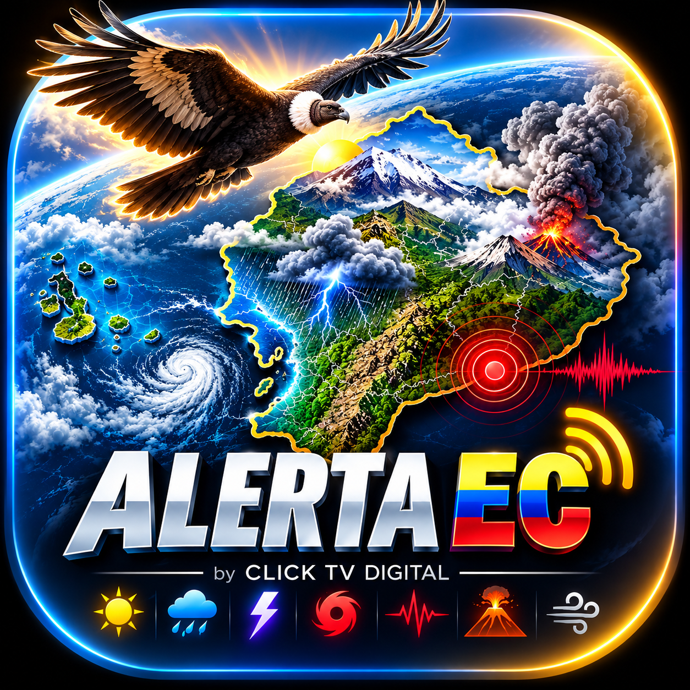

# Alerta EC

**Alerta EC**, de Click TV Digital, es una app de alertas tempranas y monitoreo meteorológico en tiempo real para Ecuador. Muestra el clima, los avisos vigentes y las capas de radar y pronóstico de INAMHI. Funciona en celulares y en Android TV / TV Box.

## Funciones principales

- **Alertas tempranas:** avisos oficiales del INAMHI (vía el centro de alertas de la WMO, activos por defecto en Ecuador) y eventos derivados del pronóstico, con notificaciones y tonos por tipo de evento.
- **Pronóstico por horas y por días:** cada hora y cada día tienen su propio detalle (tocar en el celular, OK en TV).
- **Mapas de INAMHI:** capas de radar y pronóstico (WMS), con consulta por refresco y uso sin GPS.
- **Satélite NOAA GOES-19:** nubes, rayos y nubes de tormenta encuadrados en Ecuador continental, más el mapa completo del norte de Sudamérica.
- **Cielo de un vistazo:** ícono grande de sol, nubes, luna o lluvia según la hora y el clima.
- Reseñas y reportes ciudadanos con evidencia y GPS voluntario.
- **Ubicaciones:** lugares guardados; la ubicación actual se pide al agregarla si el dispositivo tiene GPS.

## Una sola app para celular y TV

Un único APK se adapta al dispositivo, sin módulos separados:

| | Celular | Android TV / TV Box |
|---|---|---|
| Orientación | Vertical (1080p) | Horizontal (720p y 1080p) |
| Entrada | Táctil y deslizamiento | Control remoto (D-pad + OK) |
| Intro cinematográfica | Video vertical 720×1280 | 1920×1080 en Android TV · 1280×720 en TV Box de 1 GB |
| Recursos | `res/` por defecto | Calificadores `-television` / `-w640dp` |

Se mantiene un solo módulo porque toda la lógica (alertas, datos, mapas) es común. Lo que cambia es la presentación, y Android ya la separa con calificadores de recursos y con la detección de TV en tiempo de ejecución.

## Control remoto (Android TV y TV Box)

| Tecla | Acción |
|---|---|
| Flechas | Mover el foco entre tarjetas; IZQ/DER recorren horas y días con scroll automático |
| OK | Abrir la tarjeta, hora o día enfocado (mismo detalle que al tocar en el celular) |
| ARRIBA desde la primera fila | Barra superior: ubicaciones, **Ajustes**, más opciones |
| Atrás | Cierra lo abierto (intro, diálogos) y luego sale |
| Mantener ABAJO (≈2 s) | Actualizar la pantalla principal |

El foco se marca con un anillo azul marino y ámbar, legible a 3 m sobre fondos claros y oscuros. Mientras haya una alerta vigente, la pantalla no se apaga ni entra el salvapantallas.

> En muchos televisores (por ejemplo, con panel MStar) la tecla **MENÚ** la usa el propio TV. Por eso Ajustes también está en la barra superior.

## Arquitectura y rendimiento

- Android nativo en **Kotlin** (Views + Jetpack Compose), con los módulos `app`, `data`, `domain` y utilidades de clima. Está basada en [Breezy Weather](https://github.com/breezy-weather/breezy-weather) (LGPL-3.0).
- Diseñada para equipos con **1 GB de RAM**: imágenes decodificadas a su tamaño en pantalla, sombras ligeras y foco sin desenfoques.
- APK separados para `armeabi-v7a` (TV Box de 32 bits) y `arm64-v8a`.

## Compilación y releases

- **CI:** `alerta-ec-ci.yml` valida recursos, documentación y el intro, y corre las pruebas unitarias en cada push o PR hacia `alerta-ec`.
- **APK de prueba:** `alerta-ec.yml` (manual, desde Actions) publica el artefacto `Alerta-EC-Debug`.
- **Release:** `alerta-ec-release.yml` publica los APK firmados al subir un tag `vMAJOR.MINOR.PATCH` (por ejemplo `v0.1.15`).
- **Local:** `./gradlew :app:testBasicDebugUnitTest` corre las pruebas unitarias si hay toolchain Android disponible.

## Documentación

- [`CONTINUAR_AQUI.md`](CONTINUAR_AQUI.md): estado actual, ramas, herramientas y próximos pasos.
- [`docs/HISTORIAL_README.md`](docs/HISTORIAL_README.md): bitácora histórica del proyecto.
- [`PRIVACY.md`](PRIVACY.md) y [`LICENSE`](LICENSE).

---## Descarga y compatibilidad

Alerta EC es **un único proyecto** para celulares Android y Android TV / TV Box, compilado con un APK firmado por arquitectura para actualizar encima de la misma firma sin conflictos:

- **64 bits (`arm64-v8a`):** `Alerta-EC-vX.Y.Z-arm64-v8a.apk` (celulares y equipos Android de 64 bits).
- **32 bits (`armeabi-v7a`):** `Alerta-EC-vX.Y.Z-armeabi-v7a.apk` (celulares y TV Box de 32 bits).

Desde **Acerca de → Buscar actualizaciones** en la app (o desde el Release oficial en GitHub), se selecciona el paquete compatible con la arquitectura del dispositivo y se abre el instalador del sistema. Si Android lo solicita por primera vez, habilita *Instalar apps desconocidas* para la app o navegador que uses.

