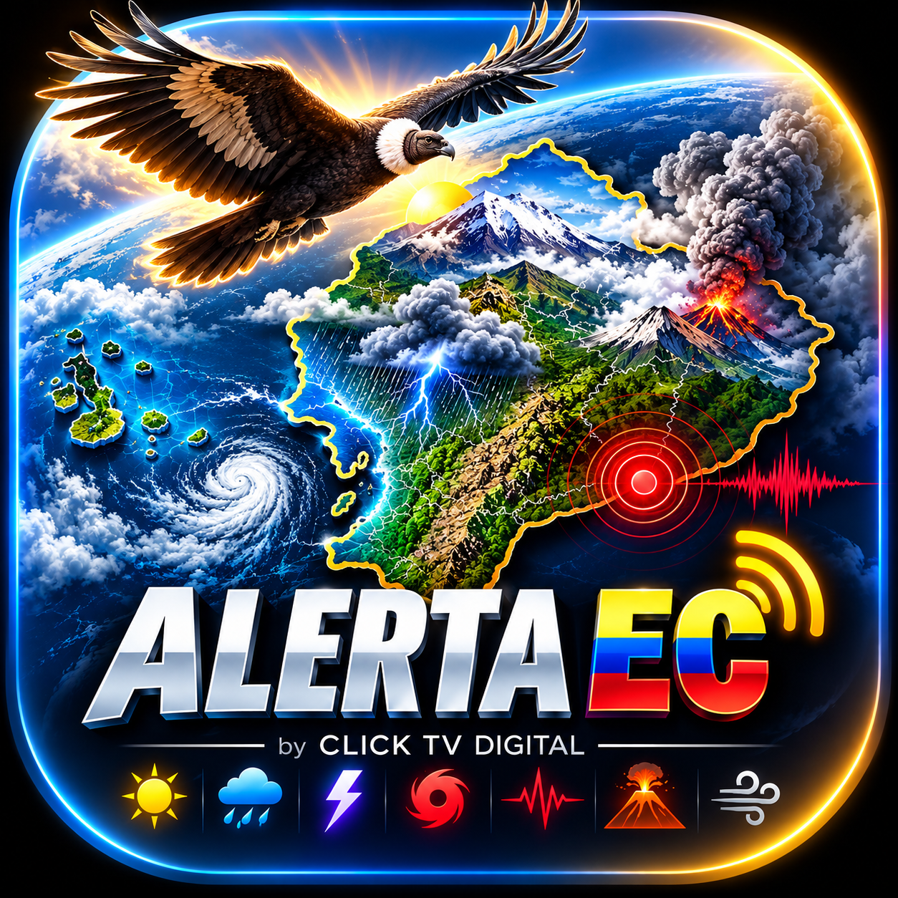

# Cambios de ALERTA EC

Registro en español de las compilaciones de ALERTA EC (rama `alerta-ec`). Lo más reciente va arriba.
Los 4 perfiles de APK de cada compilación se describen en [README.md](../README.md#descargas-directas).

## 🗓️ Resumen del 25-11-2026

Jornada de tres versiones (**v0.1.23 → v0.1.25**) centrada en que cada aviso se escuche **una sola vez y con el sonido correcto**:

- 🔔 Un canal por fenómeno, tono propio para la niebla, voz de lluvia próxima y aviso al despejar.
- 🏠 Tarjeta de alertas del inicio que se cierra deslizando o con X, y que se puede ubicar arriba, abajo u ocultar.
- 🔄 Buscador de actualizaciones y «Novedades» alineados con la versión publicada.
- 🚀 Release v0.1.25 en GitHub con notas completas ([docs/releases/v0.1.25.md](releases/v0.1.25.md)), así las versiones anteriores que consultan GitHub Releases también la ven.
- 🛠️ Mantenimiento: la prueba de Release firmada (`alerta-ec-release-test.yml`) lee la versión desde Gradle en lugar de exigir v0.1.11. La firma de producción y los 4 perfiles de APK no cambian.
- 🧹 Se cerraron los PR #1 y #2 (v0.1.15 y README antiguo), ya reemplazados por la línea actual.
- 🍏 **Nueva Web App oficial para iPhone** en https://clicktvdigital.github.io/Alerta-EC/iphone/ (PWA para Safari iOS, fuentes en `docs/web-iphone/`):
  - Clima actual, sensación térmica, lluvia, pronóstico por horas y 7 días (Open-Meteo, con respaldo de MET Norway), por GPS, ciudad o sector de Ecuador.
  - Índice de riesgo de lluvia 0-100 (🟢 Tranquilo, 🟡 Atento, 🟠 Precaución, 🔴 Peligro) con la misma fórmula que la app de Android.
  - Mapa ligero de Ecuador y reportes de la comunidad (Supabase, clave pública `anon` inyectada en el despliegue): ver, enviar y denunciar.
  - Guía de instalación en 2 pasos (Compartir → «Agregar a inicio»), funcionamiento a pantalla completa y caché básica sin conexión.
  - Se publica con el mismo workflow de descargas; los 4 APK y `version.json` no cambian.

## v0.1.25 (127) · 25-11-2026

- **Buscar actualizaciones (Acerca de):**
  - Compara el `versionCode` publicado en `version.json` del sitio de descargas y, si falta, compara el `versionName` parte por parte.
  - Abre la página del perfil correcto (`celular`, `celular-v7` o `tv`). Si no hay novedades, muestra la versión y el código instalados.
  - Las versiones 0.1.23 y anteriores todavía consultan GitHub Releases (última: v0.1.22), así que no pueden ver las nuevas hasta actualizar una vez a mano.
- **Sonidos sin duplicados:**
  - Hay un solo canal por fenómeno, con nombre en español: Lluvia, Tormenta y rayos, Granizo, Viento fuerte, Niebla y neblina, Sismo y tsunami, Inundación y deslizamiento, Actividad volcánica e incendios, y Alerta crítica.
  - Se eliminan las copias «sin vibración» de la v5, que tenían el mismo nombre. La app vibra con el patrón del fenómeno si la vibración está activada.
  - Los canales de solo vibración y sin sonido muestran su variante en el nombre.
- **Sonido del fenómeno real:**
  - La niebla y la neblina tienen un tono propio, nuevo y original.
  - Al despejar tras lluvia, tormenta, niebla o viento suena un tono suave y la voz dice «Ya despejó en …».
- **Sin silencio:** todos los canales de sonido de ALERTA EC tienen importancia alta, con aviso emergente y sonido. Alertas, lluvia, sonido, vibración y voz vienen activados.
- **Voz de lluvia próxima:** «Atención, va a llover pronto en …», una vez por episodio de lluvia.
- **Una sola notificación sonora y una sola voz por actualización:**
  - Si en el mismo ciclo coinciden alerta oficial, lluvia próxima, eventos y condición actual, solo suena el primero en ese orden; los demás se publican en silencio.
  - Las alertas extremas oficiales siempre suenan.

## v0.1.24 (126) · 25-11-2026

- **Alertas en el inicio:**
  - La tarjeta de alertas meteorológicas se cierra deslizándola a la izquierda o a la derecha, o con su botón X. El botón se puede enfocar con el control remoto (D-pad + OK) y tocar en el celular.
  - Vuelve sola cuando llega una alerta nueva.
  - Un botón «Mover abajo / Mover arriba» dentro de la tarjeta cambia su posición, y el ajuste «Pantalla principal → Alertas en el inicio» deja elegir Arriba, Abajo u Ocultas.
- **Versión alineada:**
  - El buscador de actualizaciones y el enlace «Novedades» ahora usan el sitio de descargas (`version.json`), que siempre tiene la compilación actual.
  - Antes consultaban GitHub Releases, donde la última publicación sigue siendo v0.1.22. Eso hacía aparecer la 0.1.22 estando en la 0.1.23, y además el enlace de novedades llevaba a una página inexistente.

## v0.1.23 (125) · 25-11-2026

- Nueva versión para que Android y los usuarios reconozcan la actualización respecto a v0.1.22 (124). Incluye todos los cambios listados abajo y las descargas directas firmadas.

## v0.1.22 · compilaciones del 24 y 25-11-2026

### Descargas y compilación
- Descargas directas en GitHub Pages con una página corta por perfil (vista previa para WhatsApp/redes y descarga automática). Los 4 APK van firmados con la clave de producción y se verifica el certificado SHA-256 antes de publicar. No se crean etiquetas ni Releases (`.github/workflows/alerta-ec-descargas.yml`, `scripts/build_download_site.py`).
- La clave pública de Supabase (`ALERTAEC_SUPABASE_ANON_KEY`) se inyecta desde GitHub Secrets en CI, Release y Descargas. Gradle rechaza claves `service_role`/`sb_secret_` y avisa si la clave falta.

### Notificaciones, sonido y voz
- La notificación fija del clima usa un canal silencioso nuevo (`widget_silent_v2`) y el canal antiguo con tono genérico de Android se elimina.
- Al actualizar con novedad (niebla, lluvia, tormenta, granizo, viento o nieve) suena el tono propio de ALERTA EC del fenómeno y luego la voz, p. ej. «Estamos con niebla ahorita en Quito. 12 grados. Usa luces bajas.» Una sola vez por cambio (no se repite en 2 horas).
- Cada notificación o evento se dice en voz alta una sola vez.
- Vienen activados por defecto: notificación del clima por horas, temperatura en la barra de estado, sensación térmica, sonido y vibración de lluvia e iconos monocromos.

### Inicio y pronóstico
- Tarjeta «Lluvia ahora» con un índice de riesgo de 0 a 100 (Tranquilo, Atento, Precaución o Peligro) y el botón «¿Por qué este nivel?» con sus razones: probabilidad, milímetros previstos, minuto a minuto, pluviómetros EPMAPS, INAMHI WRF y reportes de la comunidad.
- Botones de estilo neón transparentes con foco visible. Los de «Abrir mapa» y «Colaborar» se apilan en celulares para que no se corten.
- Pronóstico diario extendido a 16 días con Open-Meteo después del último día de MET Norway.
- Bloque de reloj por defecto, recomendaciones de abrigo, calor y conducción, y guía de intensidad alineada.
- Unidades de Ecuador por defecto (°C, mm, km/h, km, hPa), con una explicación y un ejemplo práctico en cada bloque de «Apariencia → Unidades».

### Mapa y satélite
- Mapa centrado en Ecuador, con flechas, zoom con OK, retroceso por capas y foco neón para el control remoto.
- Capas INAMHI de lluvia 3 h, humedad 1 h, temperatura 1 h y 3 h y viento, con reproducción y pausa, leyenda de colores y «Capa zona».
- Satélite GOES-19 (NOAA) en modos Nubes, Lluvia, Rayos y Amplia, con tamaño compacto en TV y equipos con poca memoria.

### Comunidad (Supabase)
- Reportes comunitarios con severidad (Leve, Moderada, Alta o Crítica), lista de reportes cercanos y denuncias. Tres denuncias ocultan un reporte.
- Solo usa la clave pública. Las reglas RLS y los límites anti-abuso están en `docs/supabase/alerta_ec_comunidad.sql`.
- Las coordenadas se redondean a unos 1 km y solo se envían si el usuario lo marca.

### Autosoporte
- Si un dato no trae fecha propia, se usa la fecha real de la última actualización que lo guardó, así que ya no aparece «No consta fecha de adquisición verificable». Si los datos están viejos, el autosoporte pide una actualización segura por sí mismo.
- En Android TV, la falta de GPS ya no cuenta como fallo.

### Televisión y arranque
- Intro adaptada a cada perfil (TV FHD, TV Box HD y celular vertical), banner 16:9 de TV y navegación completa con el control remoto (D-pad).
- Fuentes de Ecuador (EPMAPS e INAMHI) en la cabecera y actualización inmediata al elegir una ubicación.
