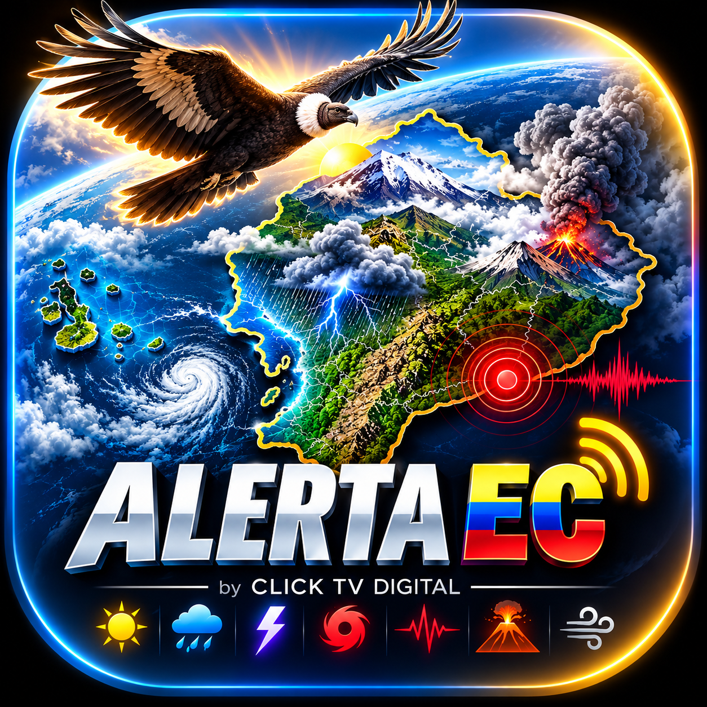

  

<h2 align="center">ALERTA EC v0.1.25 (127) · 25 de noviembre de 2026</h2>

<b>Alertas de clima, lluvia y riesgos para Ecuador</b> · celular, Smart TV y TV Box · por CLICK TV DIGITAL

---

### ✨ Lo más destacado de la jornada

Este lanzamiento reúne las versiones **v0.1.23, v0.1.24 y v0.1.25**, todas publicadas el 25-11-2026.

#### 🔔 Sonidos y voz más claros (v0.1.25)
- 🎚️ **Un solo canal por fenómeno**, con nombre en español: Lluvia, Tormenta y rayos, Granizo, Viento fuerte, Niebla y neblina, Sismo y tsunami, Inundación y deslizamiento, Actividad volcánica e incendios, y Alerta crítica. Sin copias duplicadas.
- 🌫️ **Tono propio para la niebla y la neblina**, nuevo y original.
- 🌧️ **Voz de lluvia próxima:** «Atención, va a llover pronto en …», una sola vez por episodio.
- 🌤️ **Aviso al despejar:** tono suave y la voz dice «Ya despejó en …».
- 🔕➡️🔊 **Una sola notificación sonora y una sola voz por actualización.** Las alertas extremas oficiales siempre suenan.
- 📣 Canales de ALERTA EC con importancia alta, aviso emergente y sonido activados por defecto.

#### 🏠 Alertas en el inicio (v0.1.24)
- 👆 Cierra la tarjeta de alertas **deslizándola** o con su **botón X** (también con el control remoto: D-pad + OK).
- 🔁 Vuelve sola cuando llega una alerta nueva.
- ↕️ Elige su posición: **Arriba, Abajo u Ocultas** («Pantalla principal → Alertas en el inicio»).

#### 🔄 Actualizaciones sin confusiones (v0.1.23 – v0.1.25)
- 🔎 «Buscar actualizaciones» compara el `versionCode` publicado y abre la página del perfil correcto de tu equipo.
- 📰 El enlace «Novedades» lleva siempre a la versión vigente.

#### 🛠️ Calidad y mantenimiento
- ✅ Verificación continua, descargas directas e índice de código en verde en la rama `alerta-ec`.
- 🧪 La prueba de Release firmada ya no está atada a la v0.1.11: valida la versión que indica Gradle, con la misma firma de producción.
- 🧹 Se cerraron las solicitudes antiguas que la línea v0.1.16 – v0.1.25 ya reemplazó.

---

### 📲 Descarga directa por equipo

| Equipo | Enlace | APK |
| --- | --- | --- |
| 📱 Celular (64 bits, recomendado) | https://clicktvdigital.github.io/Alerta-EC/celular/ | `alertaec-phone-arm64-v8a.apk` |
| 📱 Celular antiguo (32 bits) | https://clicktvdigital.github.io/Alerta-EC/celular-v7/ | `alertaec-phone-armeabi-v7a.apk` |
| 📺 Smart TV Full HD | https://clicktvdigital.github.io/Alerta-EC/tv/ | `alertaec-tv-fhd-armeabi-v7a.apk` |
| 📦 TV Box HD | https://clicktvdigital.github.io/Alerta-EC/tvbox/ | `alertaec-tvbox-hd-armeabi-v7a.apk` |

🔐 Todos los APK van firmados con la clave de producción de ALERTA EC y se instalan **encima** de la versión anterior, sin perder tus datos. Sumas SHA-256: https://clicktvdigital.github.io/Alerta-EC/apk/SHA256SUMS.txt

📖 Historial completo: [docs/CHANGELOG_ALERTA_EC.md](https://github.com/clicktvdigital/Alerta-EC/blob/alerta-ec/docs/CHANGELOG_ALERTA_EC.md)
