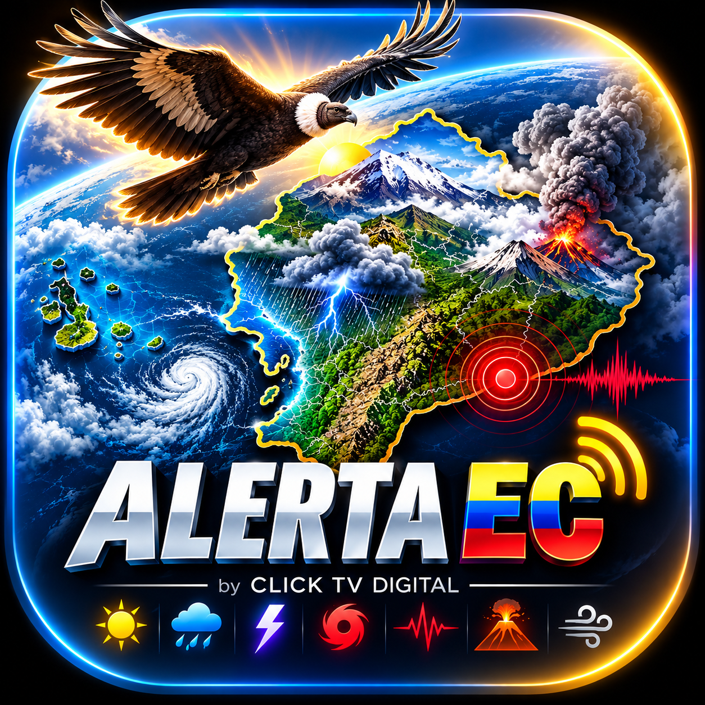

  

<h2 align="center">ALERTA EC v0.1.26 (128) · 25 de noviembre de 2026</h2>

<b>Alertas de clima, lluvia y riesgos para Ecuador</b> · celular, Smart TV y TV Box · por CLICK TV DIGITAL

---

### ✨ Lo más destacado

Este lanzamiento reúne **v0.1.23 a v0.1.26**: GitHub solo tenía publicada la v0.1.22, por eso Obtainium la mostraba como la última.

#### 📺 Control remoto completo (v0.1.26)
- **Configuración** (todas sus pantallas) y **Acerca de**: ARRIBA/ABAJO recorren cada opción y desplazan la lista hasta mostrarla; si ya no hay opciones, la lista sigue bajando para leer el texto. IZQUIERDA/DERECHA y OK/ENTER funcionan en los controles de cada fila.
- Foco **neón cian** con borde y brillo en Smart TV y TV Box, sin el fondo morado de antes.
- También se detectan como TV los TV Box sin pantalla táctil que no se declaran como Android TV.

#### 🏠 Alertas en el inicio (v0.1.24)
- Desliza la tarjeta de alertas a **izquierda o derecha**, o pulsa su **X** (enfocable con el control), para cerrarla; vuelve cuando llega una alerta nueva.
- Botón «Mover arriba / abajo» y opción en Configuración → Pantalla principal: arriba, abajo u ocultas.

#### 🔔 Sonidos y voz (v0.1.25)
- Un canal por fenómeno, tono propio para la niebla, voz de lluvia próxima y aviso al despejar; una sola notificación sonora por actualización.

#### 🔄 Actualizaciones (v0.1.23 – v0.1.26)
- «Buscar actualizaciones» compara el `versionCode` publicado y abre el enlace del perfil de tu equipo.
- El Release de GitHub adjunta los 4 perfiles de APK para Obtainium.

---

### 📲 Descarga directa por equipo

| Equipo | Enlace | APK |
| --- | --- | --- |
| 📱 Celular (64 bits, recomendado) | https://clicktvdigital.github.io/Alerta-EC/celular/ | `alertaec-phone-arm64-v8a.apk` |
| 📱 Celular antiguo (32 bits) | https://clicktvdigital.github.io/Alerta-EC/celular-v7/ | `alertaec-phone-armeabi-v7a.apk` |
| 📺 Smart TV Full HD | https://clicktvdigital.github.io/Alerta-EC/tv/ | `alertaec-tv-fhd-armeabi-v7a.apk` |
| 📦 TV Box HD | https://clicktvdigital.github.io/Alerta-EC/tvbox/ | `alertaec-tvbox-hd-armeabi-v7a.apk` |

📎 Este Release adjunta los mismos 4 APK con esos nombres exactos, `SHA256SUMS.txt` y el APK universal `Alerta-EC-v0.1.26.apk`.

🔐 Todos los APK van firmados con la clave de producción de ALERTA EC y se instalan **encima** de la versión anterior, sin perder tus datos. Sumas SHA-256: https://clicktvdigital.github.io/Alerta-EC/apk/SHA256SUMS.txt

### 📦 Actualizar con Obtainium

1. **Agregar app** → URL de origen: `https://github.com/clicktvdigital/Alerta-EC` (fuente **GitHub**).
2. Activa **«Filtrar APK por expresión regular»** con el perfil de tu equipo:

| Equipo | Filtro de APK (regex) |
| --- | --- |
| 📱 Celular (64 bits) | `^alertaec-phone-arm64-v8a\.apk$` |
| 📱 Celular antiguo (32 bits) | `^alertaec-phone-armeabi-v7a\.apk$` |
| 📺 Smart TV Full HD | `^alertaec-tv-fhd-armeabi-v7a\.apk$` |
| 📦 TV Box HD | `^alertaec-tvbox-hd-armeabi-v7a\.apk$` |

3. Deja **desactivadas** «Incluir prereleases» y «Usar la fecha como versión». Obtainium toma la versión de la etiqueta (`v0.1.26` → `0.1.26`) y Android compara el `versionCode` (128).
4. Firma de producción (SHA-256 del certificado): `06badd26afa4dfe2653209d6d4e9431ef4cffbd535c9d55297aa24f8df7a125e`.

📖 Historial completo: [docs/CHANGELOG_ALERTA_EC.md](https://github.com/clicktvdigital/Alerta-EC/blob/alerta-ec/docs/CHANGELOG_ALERTA_EC.md)
