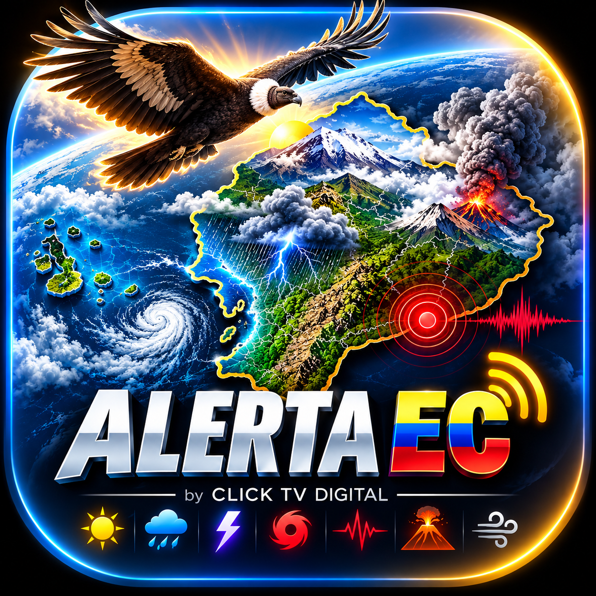

  

<h2 align="center">ALERTA EC v0.1.27 (129) · 25 de noviembre de 2026</h2>

<b>Alertas de clima, lluvia y riesgos para Ecuador</b> · celular, Smart TV y TV Box · por CLICK TV DIGITAL

---

### ✨ Lo más destacado

#### 📺 Control remoto corregido de verdad en Configuración y Acerca de
- En la v0.1.26, ARRIBA/ABAJO todavía no se movían por las opciones en Smart TV y TV Box: el foco caía en la lista completa (invisible) en lugar de la primera opción.
- Ahora el foco entra directo a la opción más cercana. **ARRIBA/ABAJO** recorren cada bloque, fila, interruptor y botón, y la lista se desplaza sola y con suavidad para que el foco nunca quede fuera de la pantalla.
- **IZQUIERDA/DERECHA** y **OK** siguen funcionando en cada fila. El foco **neón cian** se mantiene, sin fondo morado.
- Aplica a todas las pantallas de Configuración (Actualización de datos, Apariencia, Pantalla principal, Notificaciones…), Autosoporte y Acerca de (Buscar actualizaciones, Contacto, Apoyar el proyecto…).

---

### 📲 Descarga directa por equipo

| Equipo | Enlace | APK |
| --- | --- | --- |
| 📱 Celular (64 bits, recomendado) | https://clicktvdigital.github.io/Alerta-EC/celular/ | `alertaec-phone-arm64-v8a.apk` |
| 📱 Celular antiguo (32 bits) | https://clicktvdigital.github.io/Alerta-EC/celular-v7/ | `alertaec-phone-armeabi-v7a.apk` |
| 📺 Smart TV Full HD | https://clicktvdigital.github.io/Alerta-EC/tv/ | `alertaec-tv-fhd-armeabi-v7a.apk` |
| 📦 TV Box HD | https://clicktvdigital.github.io/Alerta-EC/tvbox/ | `alertaec-tvbox-hd-armeabi-v7a.apk` |

📎 Este Release adjunta los mismos 4 APK con esos nombres exactos, `SHA256SUMS.txt` y el APK universal `Alerta-EC-v0.1.27.apk`.

🔐 Todos los APK van firmados con la clave de producción de ALERTA EC y se instalan **encima** de la versión anterior, sin perder tus datos. Sumas SHA-256: https://clicktvdigital.github.io/Alerta-EC/apk/SHA256SUMS.txt

### 📦 Actualizar con Obtainium

1. **Agregar app** → URL de origen: `https://github.com/clicktvdigital/Alerta-EC` (fuente **GitHub**).
2. Activa **«Filtrar APK por expresión regular»** con el perfil de tu equipo:

| Equipo | Filtro de APK (regex) |
| --- | --- |
| 📱 Celular (64 bits) | `^alertaec-phone-arm64-v8a\.apk$` |
| 📱 Celular antiguo (32 bits) | `^alertaec-phone-armeabi-v7a\.apk$` |
| 📺 Smart TV Full HD | `^alertaec-tv-fhd-armeabi-v7a\.apk$` |
| 📦 TV Box HD | `^alertaec-tvbox-hd-armeabi-v7a\.apk$` |

3. Deja **desactivadas** «Incluir prereleases» y «Usar la fecha como versión». Obtainium toma la versión de la etiqueta (`v0.1.27` → `0.1.27`) y Android compara el `versionCode` (129).
4. Firma de producción (SHA-256 del certificado): `06badd26afa4dfe2653209d6d4e9431ef4cffbd535c9d55297aa24f8df7a125e`.

📖 Historial completo: [docs/CHANGELOG_ALERTA_EC.md](https://github.com/clicktvdigital/Alerta-EC/blob/alerta-ec/docs/CHANGELOG_ALERTA_EC.md)
